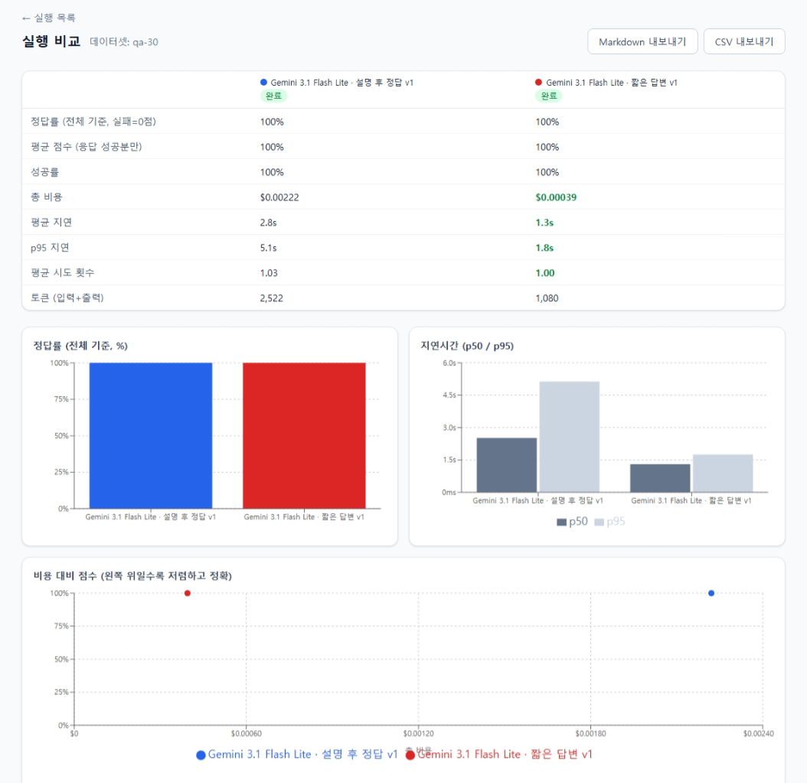

# llm-eval-board

같은 질문 묶음을 여러 LLM 모델·프롬프트로 돌려서 **정확도·비용·지연·실패율**을 한 화면에서 비교하는 평가 대시보드입니다.
"어느 모델이 우리 용도에 더 맞지?"를 감이 아니라 숫자로 답하기 위해 만들었고, 외부 LLM API가 불안정해도 **끝까지 돌고, 끊겨도 이어서 돌고, 같은 실행이 두 번 시작되지 않는** 실행 엔진에 가장 공을 들였습니다.


## 실험 결과: 프롬프트 비교

> 데이터셋 `qa-30`(상식·IT 단답형 30문항, `samples/qa-30.csv`), 모델 `gemini-3.1-flash-lite`(고정), 채점 "정답 포함", Gemini 무료 티어 키(`LLM_RPM=5`)로 2026-11-18에 실행했습니다. 비용은 공식 가격표 단가(입력 $0.25 / 출력 $1.50 per 1M tokens, 2026-11 기준)로 환산한 **추정값**이며 실제 청구액이 아닙니다.

두 프롬프트: **짧은 답변**("정답만 짧게 답하세요. 설명은 쓰지 마세요.") vs **설명 후 정답**("한두 문장으로 이유를 설명한 뒤 마지막 줄에 정답만 쓰세요.")

| | 설명 후 정답 | 짧은 답변 |
| --- | --- | --- |
| 정답률 (전체 기준, 실패=0점) | 100% | 100% |
| 성공률 | 100% | 100% |
| 총 비용 (추정) | $0.00222 | **$0.00039** |
| 평균 지연 / p95 | 2.8s / 5.1s | **1.3s / 1.8s** |
| 평균 시도 횟수 | 1.03 | 1.00 |
| 토큰 (입력+출력) | 2,522 | 1,080 |



**해석**
- 정답률은 둘 다 100%라서 **이 데이터셋으로는 두 프롬프트의 정확도를 구분할 수 없습니다.** 질문이 쉬워서 점수가 천장에 닿은 것입니다(천장 효과).
- 정확도가 같으므로 비용과 지연이 판단 기준이 됩니다. 설명을 덧붙인 프롬프트는 토큰이 약 2.3배인데 **비용은 약 5.7배, 평균 지연은 약 2.2배**였습니다. 출력 토큰 단가가 입력의 6배라 출력이 늘수록 비용이 더 가파르게 늘기 때문입니다. 이 용도에서는 "짧은 답변"이 낫다는 결론입니다.
- 정확도 차이를 가려내려면 더 어려운 질문(헷갈리는 사실, 추론이 필요한 문제)이 필요합니다. 평가 도구의 첫 번째 교훈이라고 생각합니다: **변별력 없는 평가셋으로는 어떤 모델·프롬프트도 구분하지 못합니다.**

**보류한 실험**: `gemini-3.8-flash`와의 모델 간 비교는 무료 티어가 이 모델을 하루 20회로 제한해(실험 중 429 `requests per day` 오류로 확인) 30문항 실행이 불가능해 보류했습니다. 한도가 풀리면 같은 데이터셋·프롬프트로 이어서 비교할 수 있습니다. 이 경우 실행 엔진은 기다리지 않고 "일일 한도 소진"으로 실행을 즉시 실패 처리합니다.

## 이 프로젝트가 다루는 문제

LLM 평가는 질문이 수십~수백 개이고 호출마다 시간이 걸리며, 외부 API는 자주 실패합니다. 그래서 점수 계산보다 **실행 안정성**이 먼저라고 보았습니다.

| 문제 | 해결 |
| --- | --- |
| 일시적 오류(503, 429, 타임아웃) | 지수 백오프 + 지터로 재시도, 오류 종류에 따라 재시도 여부 구분 |
| 호출 제한(429) | 제공자가 알려 준 대기 시간(`retryDelay`)을 따르고, `LLM_RPM`으로 모델별 호출 간격을 조절해 무료 티어(분당 5회)에서도 끝까지 동작 |
| 키 오류처럼 계속해도 의미 없는 오류 | 즉시 실행 전체를 실패 처리 (질문마다 헛호출하지 않음) |
| 서버가 중간에 꺼짐 | 부팅 시 미완료 실행을 찾아 **이미 저장된 질문은 건너뛰고 이어서 실행** |
| 같은 실행이 두 번 시작됨 | 활성 실행 중복 시 409, `Idempotency-Key` 헤더 지원, `PENDING → RUNNING` 전이는 조건부 업데이트 |
| 결과 중복 저장 | `(runId, itemId)` 유니크 + upsert |
| 외부 API 폭주 | 전역 동시 호출 제한(세마포어), 재시도 대기 중에는 자리를 반납 |
| 취소 | 실행 중 취소 요청 시 새 질문을 더 가져가지 않고 종료 |

## 기능

- **라이브러리**: 데이터셋(CSV 업로드), 프롬프트(이름별 버전 관리), 모델 설정(제공자·모델명·토큰 단가), RAG용 문서
- **실행**: 데이터셋 × 프롬프트 × 모델(여러 개 선택 가능)로 실행을 만들고 진행률을 실시간으로 확인
- **채점**: 정답 일치(`exact`), 정답 포함(`contains`), LLM 심판(`judge`, 1~5점을 0~1로 환산)
  - 심판 프롬프트는 응답 안에 섞인 지시문을 따르지 않도록 구성하고, JSON을 해석하지 못하면 점수 없이 사유만 기록
- **RAG 비교**: 문서를 문단 단위로 쪼개 BM25(한글 bigram 토큰)로 검색한 문단을 `{{context}}`에 주입. 데이터셋의 `evidence` 열로 **검색 적중률**도 측정
- **비교 화면**: 2~6개 실행을 지표 표, 차트(정답률/지연 p50·p95/비용 대비 점수), 질문별 결과(갈리는 질문, 모두 틀린 질문 필터)로 비교
- **리포트 내보내기**: 비교 결과를 Markdown / CSV로 다운로드 (CSV는 엑셀 수식 주입 방지 처리)
- **API 문서**: `/docs` (Swagger), 구조화 로그(JSON, 모든 줄에 `runId`)

## 지표 정의

| 지표 | 정의 |
| --- | --- |
| 정답률 | 전체 질문 기준 평균 점수. **호출에 실패한 질문은 0점**으로 센다 |
| 평균 점수 | 응답을 받은 질문만의 평균. 성공률이 낮은 실행끼리 비교하면 왜곡되므로 정답률과 함께 본다 |
| 비용 | 입력·출력 토큰 × 모델 단가(+ 심판 비용) |
| 지연 | 응답을 받은 호출의 소요 시간 (평균 / p50 / p95, nearest-rank) |
| 성공률 · 시도 횟수 | 성공한 질문 비율 · 질문당 평균 시도 횟수 (1이면 재시도 없음) |
| 검색 적중률 | 근거 글귀가 검색된 문단에 들어 있던 비율 (`evidence` 열이 있는 질문만) |

## 구조

```
┌──────────────┐  REST + JWT   ┌───────────────────────────────┐      ┌────────────┐
│ React (Vite) │ ────────────▶ │ NestJS                        │ ───▶ │ PostgreSQL │
│ 대시보드/비교  │               │  auth · workspaces · datasets │      │ (Prisma)   │
└──────────────┘               │  prompts · models · documents │      └────────────┘
                               │  runs ── RunExecutor ──┐      │
                               │  scoring · rag(BM25)   ▼      │      ┌────────────┐
                               │            LlmService ────────┼────▶ │ Gemini /   │
                               │   (RPM 제한·타임아웃·재시도)     │      │ OpenAI/mock│
                               └───────────────────────────────┘      └────────────┘
```

- `apps/api`: NestJS 12, Prisma 7, PostgreSQL 16
- `apps/web`: Vite, React 19, TypeScript, Tailwind v4, Recharts
- 실행 엔진은 **서버 프로세스 안에서** 동작합니다(별도 큐/워커 없음). 대신 모든 진행 상태를 DB에 남겨 재시작 후 복구합니다.
- 모든 데이터는 워크스페이스 단위로 분리되며, 남의 워크스페이스는 403이 아니라 **404**로 응답해 존재 여부를 드러내지 않습니다.

## 설계 결정

- **인프로세스 실행기 vs 작업 큐**: Redis 같은 외부 큐를 쓰면 구성이 무거워집니다. 단일 서버·소규모 평가가 목표라서 인프로세스로 두고, 복구 가능성(DB 상태 + 이어하기)으로 신뢰도를 확보했습니다. 서버를 여러 대로 늘리면 큐가 필요합니다(아래 한계).
- **상태 전이는 조건부 `updateMany`**: 두 번 시작 요청이 와도 한쪽만 성공하도록 DB가 직렬화합니다. 애플리케이션 락 대신 DB 조건을 믿습니다.
- **재시도 대기는 자리를 잡지 않음**: 세마포어는 호출 1회 단위로만 잡아서, 한 질문이 백오프로 쉬는 동안 다른 질문이 자리를 씁니다.
- **429는 힌트를 존중**: 제공자가 "29초 뒤에"라고 알려 주면 짧은 백오프를 무시하고 그만큼 기다립니다. 하루 한도처럼 너무 긴 대기는 상한(`LLM_RETRY_AFTER_MAX_MS`)에서 끊습니다.
- **채점 실패는 생성 결과를 버리지 않음**: 심판이 실패해도 응답과 비용은 저장하고 `scoreError`만 남깁니다.
- **평균 점수 대신 전체 기준 정답률을 기본 지표로**: 실패를 빼고 평균을 내면 호출이 막힌 모델이 오히려 정확해 보이는 문제가 실제로 있었습니다(무료 티어 429 실험).

## 테스트와 CI

- 단위 테스트: 재시도·백오프, 세마포어, 호출 간격 제한, 429 파싱, 채점기, BM25, 지표 계산, 로그 형식
- 통합 테스트(`apps/api/test`): 실제 PostgreSQL에 대해 인증, 워크스페이스 격리, 입력 검증, 실행 완료, 재시도 후 성공, 키 오류 즉시 실패, 중복 실행 409·취소, `Idempotency-Key`, 중단된 실행 이어하기, RAG, 비교 API를 검증
- GitHub Actions: PostgreSQL 서비스 컨테이너를 띄워 `lint → build → 단위 → migrate → 통합` 순으로 실행, 웹은 `lint → build`

## 실행 방법

```bash
docker compose up -d                       # PostgreSQL
cd apps/api
cp ../../.env.example .env                 # GEMINI_API_KEY 등을 채운다 (.env 는 커밋하지 않는다)
npm install
npx prisma migrate dev
npm run start:dev                          # http://localhost:3000  (API 문서: /docs)

cd ../web
npm install
npm run dev                                # http://localhost:5173
```

키 없이 둘러보려면 모델 탭의 "데모용 mock 모델 추가"를 쓰세요. 일부러 실패하는 `mock-flaky`, 완전히 죽은 `mock-down` 등으로 재시도·복구 동작을 확인할 수 있습니다.
무료 티어 키라면 `.env`에 `LLM_RPM=5`를 넣으세요(호출 간격을 벌려 429를 피합니다).

테스트: `cd apps/api && npm test`(단위), `npm run test:e2e`(통합, DB 필요).

| 환경변수 | 설명 |
| --- | --- |
| `DATABASE_URL`, `JWT_SECRET` | 필수 |
| `GEMINI_API_KEY`, `OPENAI_API_KEY` | 쓰는 제공자만 |
| `LLM_CONCURRENCY` `LLM_TIMEOUT_MS` `LLM_MAX_ATTEMPTS` `LLM_RETRY_BASE_MS` `LLM_RETRY_MAX_MS` `LLM_RPM` | 실행 엔진 조절 (`.env.example` 참고) |
| `WEB_ORIGIN`, `LOG_LEVEL` | CORS 허용 주소, 로그 수준 |

## 알려진 한계

- **단일 서버**: 실행기가 서버 프로세스 안에 있어 서버를 여러 대로 늘리면 같은 실행을 중복 처리할 수 있습니다. 확장하려면 작업 큐 + 분산 락이 필요합니다.
- **삭제는 연쇄**: 데이터셋·모델·프롬프트를 지우면 그것으로 돌린 실행 기록도 함께 지워집니다(화면에서 경고합니다).
- **검색은 키워드(BM25)**: 의미 기반 임베딩 검색이 아니라서 같은 뜻의 다른 표현은 찾지 못합니다.
- **심판 점수의 한계**: LLM 심판은 자기 계열 모델을 선호하는 등 편향이 있고, 사람 평가와의 일치도를 검증하지 않았습니다.
- **표본 크기와 변별력**: 질문 수가 적으면 점수 차이가 우연일 수 있고, 반복 실행이나 신뢰구간은 아직 없습니다. 기본 제공하는 `qa-30`은 쉬운 편이라 최신 모델끼리는 정확도가 모두 만점이 됩니다.
- **JWT를 `localStorage`에 저장**: XSS에 취약한 방식입니다. 실서비스라면 httpOnly 쿠키가 낫습니다.
- **OpenAI 제공자는 키가 없어 실제 호출로 검증하지 못했습니다.** Gemini와 mock으로 검증했습니다.
- 실행 목록·상세 화면의 "점수"는 아직 응답 성공분만의 평균입니다(비교 화면은 전체 기준 정답률).
